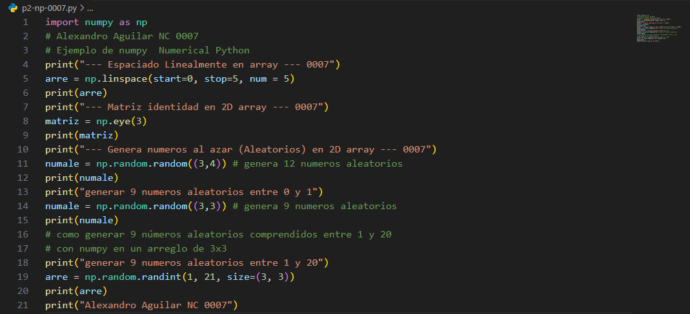
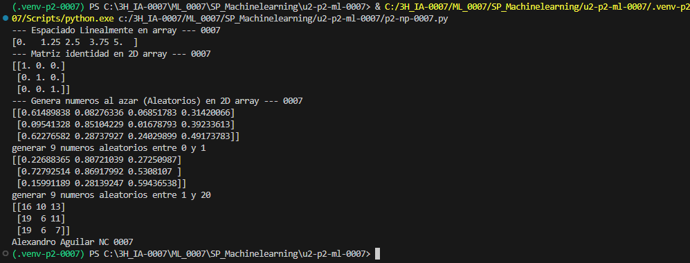

- `start=0`: Define el valor inicial desde donde comienza la secuencia de números que se van a generar.

- `stop=1`: Define el valor final hasta donde llegará la secuencia. Este valor se incluye entre los números generados.

- `num=5`: Especifica la cantidad total de números que se generarán entre el valor inicial y el final, distribuidos a intervalos iguales.

## que es np.linspace
- `np.linspace`: Función de NumPy que genera números espaciados uniformemente.

## El codigo

## Resultados

